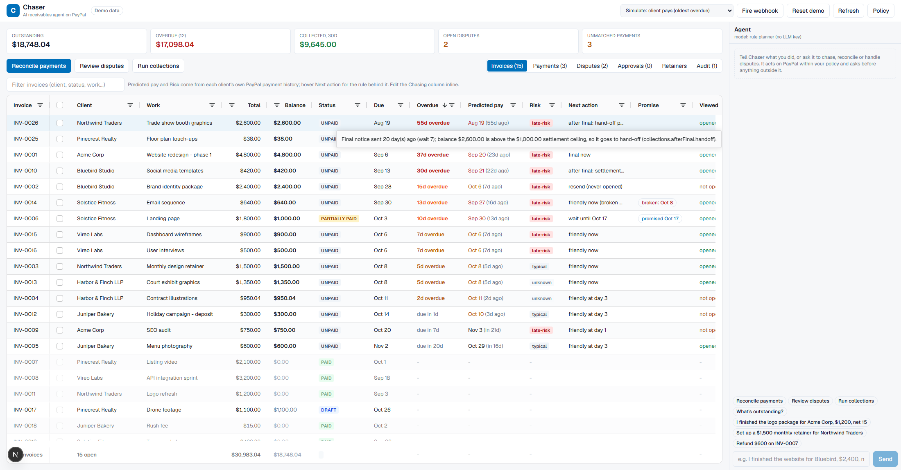
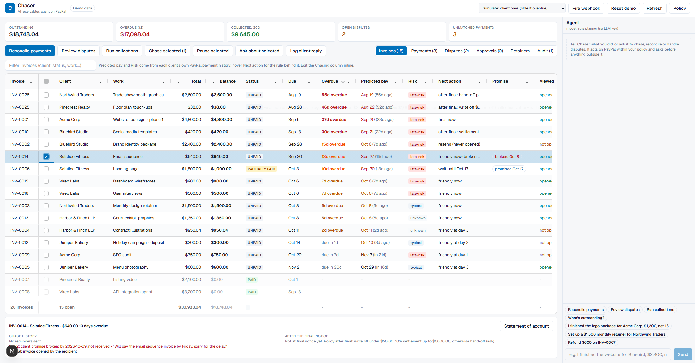
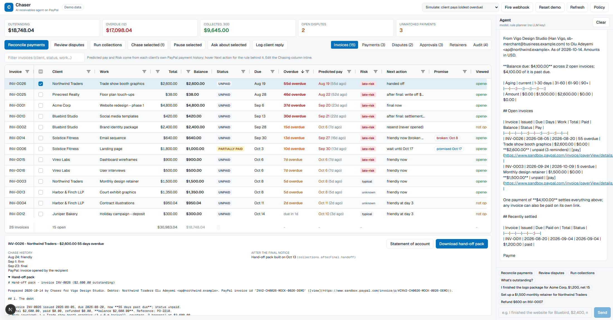
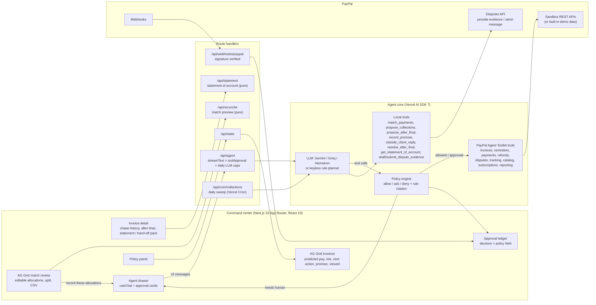
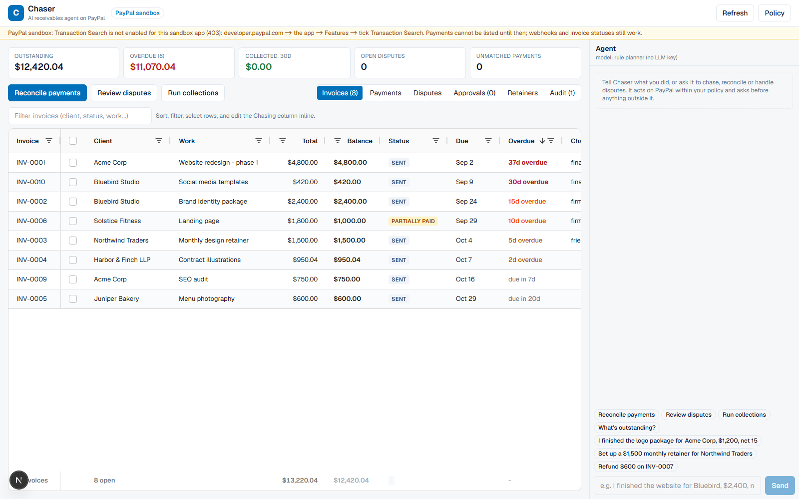
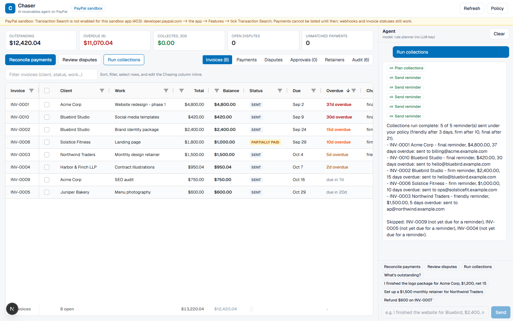
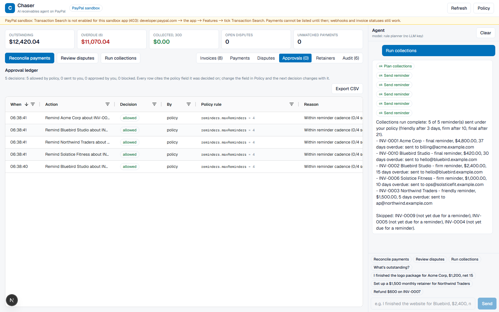
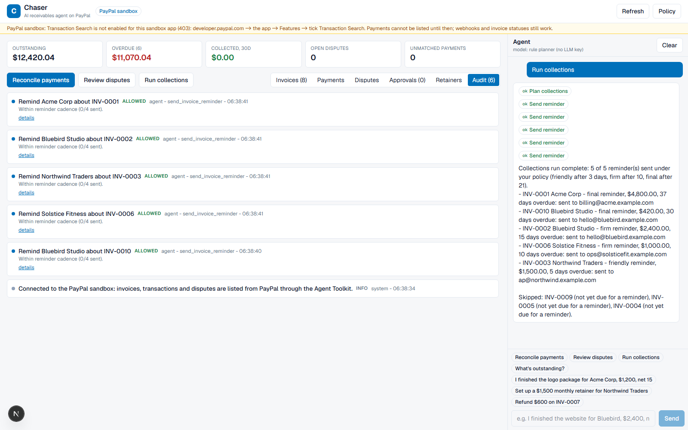

# Chaser

> Demo video (2:31): https://www.youtube.com/watch?v=nqY9uDsbKiM — Live demo: https://chaser-six.vercel.app

**Chaser matches every PayPal payment to the right invoice and handles what comes after: the chase, the promise, the dispute, and the decision when the final notice goes unanswered.**

What no other entry in this niche does (checked against 22 public PayPal AI Hackathon repos on 2026-10-13):

- **Predicted pay date and adaptive cadence from the client's own PayPal history.** Each payer's paid invoices (`payments.transactions[].payment_date` vs `due_date`) give a median lateness, a late rate and a risk band; the grid shows *Predicted pay* and *Risk*, and `reminders.adaptToHistory` brings firm/final forward for habitual late payers and back for reliable ones, with the ledger citing the numbers. `src/lib/agent/payer-history.ts`.
- **Promise to pay.** Paste a client's reply ("we'll pay the rest by the 20th"); the agent classifies it, records the promise, pauses the chase until then, and a broken promise escalates the next reminder one stage with the promise named. `src/lib/agent/promise.ts`.
- **Published matcher accuracy.** A labelled benchmark of 71 transactions over 81 invoices: 70 correct, 100% precision on everything the agent records without asking, per-rule precision/recall below and in [`docs/RECONCILIATION-BENCHMARK.md`](docs/RECONCILIATION-BENCHMARK.md). Rules include net-of-fee, refunds, duplicates, overpayments and ambiguous pairs.
- **Viewed-aware chasing.** PayPal's `detail.viewed_by_recipient` (verified in the sandbox, see [`docs/sandbox-evidence/VIEWED-BY-RECIPIENT.md`](docs/sandbox-evidence/VIEWED-BY-RECIPIENT.md)) decides between a firmer reminder and a re-delivery with an address check for an invoice the client never opened.
- **A decision after the final notice.** `collections.afterFinal` proposes a write-off (under a threshold), a settlement offer (a discounted replacement invoice) or a hand-off pack (statement of account + chase history + evidence), each approved where money is affected. Per-client statement of account as Markdown. `src/lib/agent/after-final.ts`, `src/lib/agent/statement.ts`.

Plus what Chaser already did: reconciliation with an editable AG Grid match review, policy as data with an approval ledger that names the field, dispute evidence packs through the Disputes API, webhooks, cron, a keyless demo.

**Run against a real PayPal sandbox business account on 2026-10-10:** 8 invoices created and sent through the Agent Toolkit, 5 reminders sent by the agent loop under the policy gate (3 skipped as not yet due, each decision citing its rule), an external $800 payment recorded (`EXTR-3W091620YC457544T`, INV-0006 → PARTIALLY_PAID), and the Disputes API `provide-evidence` / `send-message` calls reaching PayPal (authenticated 404 on a probe id; no success claimed). On 2026-10-14 the `viewed_by_recipient` probe read all 8 invoices again (debug ids recorded). Call-by-call JSON, audit dumps and screenshots are in [`docs/sandbox-evidence/`](docs/sandbox-evidence/); [Verified on the PayPal sandbox](#verified-on-the-paypal-sandbox) says what was and was not exercised, and [Live vs demo](#live-vs-demo-what-runs-where) says what the hosted site runs against.

Built for the [PayPal AI Hackathon](https://paypalaihackathon.devpost.com/) on the **PayPal sandbox** (play money only), with the **PayPal Agent Toolkit**, the **Vercel AI SDK** and **AG Grid Community**. Live demo: **https://chaser-six.vercel.app** (demo data, no sign-in, every visitor gets an isolated copy; the hosted site runs the keyless rule planner, the drawer header says `model: rule planner (no LLM key)`).



## Why not PayPal's built-in reminders, or a chat bot over the toolkit

PayPal already sends invoices and automatic reminders (`setup_invoice_auto_reminders`), and a chat bot over the toolkit can call `send_invoice_reminder`. Chaser is for what those do not cover:

- **Payments that PayPal cannot link to an invoice.** [`src/lib/agent/reconcile.ts`](src/lib/agent/reconcile.ts) is a pure matcher (invoice number in the memo, payer + exact balance, net of fee, payer + subset-sum across several invoices, payer + partial on the oldest, overpayment, refund, duplicate, ambiguous) that returns a rule, a confidence, a reason and an action per allocation; one transaction can carry several allocations. The match review ([`src/components/MatchReview.tsx`](src/components/MatchReview.tsx)) lets you edit, split or re-point lines before `record_payment_for_invoice` writes them to PayPal; review-only matches are never recorded by the agent.
- **A chase that reads the client, not just the calendar.** Days overdue is the only input every other entry uses. Chaser also uses the client's own payment history, PayPal's viewed flag, and the client's own words (a promise to pay), and says which one drove each reminder.
- **Dispute responses through the API the toolkit does not expose.** [`src/lib/paypal/rest.ts`](src/lib/paypal/rest.ts) calls `provide-evidence` (multipart) and `send-message` with the evidence pack assembled from invoice line items, payment record, shipment tracking and reminder history; the call path is in [`docs/sandbox-evidence/disputes-api-probe.json`](docs/sandbox-evidence/disputes-api-probe.json).
- **A policy you edit as data, and a ledger that names the field.** [`src/lib/policy/engine.ts`](src/lib/policy/engine.ts) (schema: [`src/lib/policy/schema.ts`](src/lib/policy/schema.ts)) answers allow / ask / deny for every tool call and cites the policy field; every row of [`docs/sandbox-evidence/2026-10-10-collections-audit.json`](docs/sandbox-evidence/2026-10-10-collections-audit.json) carries its `rule`.
- **An ending.** After the final notice PayPal's reminders stop and so does every other entry. Chaser's policy decides: write off, offer a settlement, or hand off with a pack a collector or a court can use.

## Reconciliation accuracy (published benchmark)

Nobody else in this niche publishes how well their matcher works, so here are the numbers. [`tests/fixtures/recon-bench.json`](tests/fixtures/recon-bench.json) is a labelled set of **71 transactions over 81 invoices** (exact, partial, split across 2-3 invoices, net of a PayPal fee, memo typos, invoices paid from a different email, overpayments, duplicates, refunds, ambiguous equal balances, wrong currency, off-invoice payments); `npm run bench:recon` scores [`src/lib/agent/reconcile.ts`](src/lib/agent/reconcile.ts) against it and writes [`docs/RECONCILIATION-BENCHMARK.md`](docs/RECONCILIATION-BENCHMARK.md). A transaction counts as correct only when the rule *and* the full allocation set (invoice numbers and amounts) match the label. [`tests/recon-bench.test.ts`](tests/recon-bench.test.ts) pins these numbers.

**70 / 71 correct (98.6%); 53 / 53 of the matches the agent would record without asking are correct (100% auto-record precision).** Ambiguous, amount-only and duplicate matches are `review` actions: shown in the match review, never recorded by the agent.

| Rule | What it matches | Labelled | Precision | Recall |
|---|---|---:|---:|---:|
| `memo_exact` | invoice number in the memo (any punctuation, `inv 0013`, `Inv. #13`), amount = balance | 8 | 100% | 100% |
| `memo_other_payer` | memo names the invoice, paid from an email that is not the client's | 3 | 100% | 100% |
| `partial_memo` | memo names the invoice, amount under the balance (instalments stack) | 4 | 100% | 100% |
| `payer_exact` | same payer, one open invoice with that balance | 11 | 100% | 100% |
| `fee_adjusted` | same payer, amount = balance net of a PayPal fee (2.9% + $0.30 .. 3.49% + $0.49, or the transaction's own fee); the fee gap is reported | 6 | 100% | 100% |
| `combined` | same payer, amount = sum of 2-4 open invoices | 6 | 100% | 100% |
| `overpayment` | same payer, at most $20 / 2% over one balance (rounded up); closes it, remainder stays unapplied | 3 | 100% | 100% |
| `partial` | same payer, less than the oldest open balance | 8 | 100% | 87.5% |
| `duplicate` (review) | same payer, same amount, same currency within 3 days of an applied payment, nothing open for it | 4 | 80% | 100% |
| `ambiguous` (review) | two invoices or two combinations fit equally | 4 | 100% | 100% |
| `amount_only` (review) | unknown payer, exactly one open invoice with that balance | 3 | 100% | 100% |
| `refund` | an unlinked refund matched to the payer's paid invoice (`record_refund_for_invoice`) | 5 | 100% | 100% |
| unmatched | wrong currency, off-invoice payments, known payer with nothing that fits | 6 | 100% | 100% |

The one miss is deliberate and documented: a second equal instalment with no memo within three days is held as a possible duplicate for review rather than recorded, which is the safer error.

## 60-second tour (no keys needed)

```bash
npm install
cp .env.example .env.local     # demo data + keyless planner by default
npm run dev                    # http://localhost:3000
```

1. **Invoices tab.** Every open invoice has a *Predicted pay* date and a *Risk* band from that client's own paid invoices (Acme and Bluebird are habitual late payers, Pinecrest is reliable), a *Next action* with the rule behind it (hover), a *Promise* chip (Solstice promised the rest of INV-0006; their promise on INV-0014 is broken) and PayPal's *Viewed* flag (INV-0002 was never opened). Select one row: the detail panel shows the chase history, the promise, what the policy will do after the final notice, and a **Statement of account** button.
2. **Run collections.** Reminders at friendly / firm / final stages, each line saying why: a late-risk payer moved to firm at day 7 instead of 10 (`reminders.adaptToHistory`), a never-opened invoice re-delivered with an address check (`reminders.unviewedStrategy`), a broken promise escalated (`promises.brokenEscalates`). Then the after-final pass: INV-0025 ($38) proposed for write-off, INV-0010 ($420) for a 10% settlement, INV-0026 ($2,600) for a hand-off pack, each an approval card because money is affected (`collections.afterFinal.*`).
3. **Log client reply.** Select INV-0013, click *Log client reply*, paste "Apologies, we will pay this by the 25th". The agent classifies it, records the promise, the grid shows *promised Oct 25*, and the next collections run skips it with the reason.
4. **Payments tab.** Three PayPal payments arrived without an invoice link. The match review already shows the agent's proposal with the rule and confidence: an exact match (95%), a partial on the oldest open invoice (70%), one $1,400 payment split across two invoices (90%). Change the $900 / $500 split to $1,000 / $400 and the over-allocation guard turns the lines red; click **Record 4 allocations**.
5. **Approval card.** Three lines are recorded straight away (`reconciliation.autoRecordExactMatches`, `autoRecordPartials`). The $1,000 line exceeds the $900 still due on INV-0015, so it comes back as an approval card quoting the rule.
6. **Approvals tab.** The ledger: `allowed` by policy, `approval required`, `approved by you`, `denied`, each row with the policy field and value it was decided on, including the cadence and channel decisions above. Open **Policy**, change a threshold, and the next decision changes with it.
7. **Review disputes.** The $15 dispute is accepted automatically (`disputes.autoAcceptUnder = $20`). For the $480 one the agent builds the evidence pack and, because `disputes.submitEvidence = ask`, shows it as an approval card; approve and it goes to PayPal through the Disputes API.
8. Type `I finished the logo package for Acme Corp, $1,200, net 15` (create + send), `Refund $600 on INV-0007` (approval card), or **Fire webhook** (`INVOICING.INVOICE.PAID` through the signature-checking handler; the payer history updates with it).

Add a free Gemini or Groq key and the same tools are driven by a real LLM; add PayPal sandbox credentials and the same agent acts on real sandbox invoices, payments and disputes.





## Live vs demo: what runs where

| Capability | Hosted demo (https://chaser-six.vercel.app) | Local with sandbox credentials (`MOCK_PAYPAL=0`) | Exercised against PayPal |
|---|---|---|---|
| Invoices, line items, due dates, `viewed_by_recipient`, `paid_at` | demo data (26 invoices) served in-process, PayPal-shaped | `list_invoices` + `get_invoice` per invoice through the toolkit | yes (2026-10-10, 2026-10-14) |
| Create + send invoices, reminders, record payments | mock executor with PayPal-shaped responses | toolkit `create_invoice`, `send_invoice`, `send_invoice_reminder`, `record_payment_for_invoice` | yes (8 / 8 / 5 / 1) |
| Payer history, predicted pay date, adaptive cadence | computed from demo invoices + transactions | computed from `payments.transactions[].payment_date` on PayPal's invoices (no Transaction Search needed) | the inputs are PayPal's; the computation is local |
| Promise to pay, broken-promise escalation | local overlay | local overlay (PayPal stores no promises); reminders still go through PayPal | the reminder path, yes |
| Viewed-aware re-delivery | demo flags (most opened, four never) | PayPal's flag; all 8 sandbox invoices are `false`, so a sandbox run re-delivers rather than escalates | the field, yes; a `true` value, not observed |
| Reconciliation against unlinked payments | demo transactions (3 unlinked + history) | `list_transactions` (Transaction Search) | **no**: 403, Transaction Search not enabled on the sandbox app (user task) |
| Refunds, dispute accept, `provide-evidence` success | mock | toolkit / REST | no buyer, no dispute: not run; call path probed (authenticated 404) |
| After-final: write-off (`cancel_sent_invoice`), settlement (`create_invoice` + `send_invoice`), hand-off pack | mock | same toolkit calls as above; the pack is local | the calls it reuses, yes; this flow end to end, no |
| Webhooks | simulated through the real handler | `verify-webhook-signature` + apply | not run (no public URL during the test) |
| LLM | keyless rule planner | Gemini / Groq / Nemotron when a key is set, daily caps | n/a |

## Architecture



**How a tool call flows.** The model proposes a tool call. The AI SDK's `toolApproval` hook asks Chaser's policy engine (`src/lib/policy/engine.ts`), a pure function over the current invoices, disputes and the user's policy. It answers *allow* (execute now), *ask* (stream an `approval-requested` part; the UI renders a card; the SDK resumes after the user's answer) or *deny* (the model receives an `execution-denied` result with the reason and reports it), and every answer names the policy field it came from. Executions, approval requests, your answers and denials are written to the audit log; the Approvals tab is that log filtered to decisions. The planning decisions that are not tool calls (a stage brought forward by payer history, a re-delivery instead of a reminder) are written to the same ledger by `propose_collections`.

**The chase, in order.** `planCollections` (`src/lib/agent/chase.ts`) takes the invoices, the policy, the clock and the transactions. For each open invoice: skip if paused or under an open promise; compute the payer's band and the shifted thresholds; pick the stage by days overdue; if a promise was broken, escalate one stage above what was sent; if PayPal says the invoice was never opened and it is old enough, switch the channel to a re-delivery; draft the reminder from the line items; attach `why` and the `rule`. Then `planAfterFinal` (`src/lib/agent/after-final.ts`) looks at invoices whose final notice is `waitDays` old and proposes exactly one of write-off / settlement / hand-off. Both are pure and unit-tested; the grid's *Next action* column calls the same functions, so what you see is what the agent will do.

**Reconciliation.** `match_payments` (`src/lib/agent/reconcile.ts`) is a pure matcher over unapplied payments and open invoices; rules and numbers above. Recording goes through `record_payment_for_invoice` / `record_refund_for_invoice` (Invoicing v2), so PayPal's invoice balances are the source of truth.

**Where state lives.** The server is stateless between requests: the browser keeps the snapshot it last received (policy, demo data, overlays, audit) and sends it with every call; each route hydrates it into an `AsyncLocalStorage` context and returns the updated snapshot (the agent stream carries it as a final `data-snapshot` part). That makes the hosted demo serverless-safe and gives every visitor an isolated copy of the business. In sandbox mode PayPal is the source of truth for invoices, transactions and disputes; the snapshot keeps only what PayPal does not store for us (policy, reminder history, chase overrides, promises, after-final resolutions, evidence drafts and submission records, audit). Server-to-server callers (PayPal webhooks, Vercel Cron) use a process-global store.

### PayPal capabilities used

Via [`@paypal/agent-toolkit`](https://www.npmjs.com/package/@paypal/agent-toolkit) 1.11.0 unless noted. `configuration.context.sandbox = true` throughout.

| Area | Tools | Where Chaser uses them |
|---|---|---|
| Invoicing v2 | `create_invoice`, `send_invoice`, `send_invoice_reminder`, `list_invoices`, `get_invoice`, `search_invoicing`, `generate_invoice_number`, `generate_invoice_qr_code`, `cancel_sent_invoice`, `record_payment_for_invoice`, `record_refund_for_invoice`, `setup_invoice_auto_reminders` | reconciliation write-back (full, partial, split, net-of-fee, refunds); creating/sending invoices from natural language and settlement offers; policy-driven chasing and re-delivery; write-offs; `payments.transactions[].payment_date` and `detail.viewed_by_recipient` as signals |
| Transaction Search / Reporting | `list_transactions` | the payment stream the matcher reconciles against open invoices |
| Disputes v1 | `list_disputes`, `get_dispute`, `accept_dispute_claim` | auto-accepting small disputes; building evidence for the rest |
| Disputes v1 (REST, not in the toolkit) | `POST /v1/customer/disputes/{id}/provide-evidence` (multipart), `POST .../send-message` | `submit_dispute_evidence`: sends the evidence pack (evidence type, tracking info, seller notes), gated by `disputes.submitEvidence` |
| Payments v2 | `create_refund` | refunds (gated by amount) |
| Shipment Tracking | `create_shipment_tracking`, `get_shipment_tracking` | "shipped the brand book, UPS 1Z..."; tracking also feeds the evidence pack |
| Catalog + Subscriptions | `create_product`, `list_products`, `create_subscription_plan`, `list_subscription_plans`, `create_subscription`, `show_subscription_details`, `cancel_subscription` | monthly retainers for regular clients |
| Webhooks (REST) | `POST /v1/notifications/verify-webhook-signature` | `/api/webhooks/paypal` verifies and applies `INVOICING.INVOICE.PAID`, `PAYMENT.CAPTURE.COMPLETED`, `CUSTOMER.DISPUTE.CREATED/RESOLVED`, `BILLING.SUBSCRIPTION.ACTIVATED` |
| OAuth (REST) | `POST /v1/oauth2/token` | client-credentials token for the REST calls above |

### The policy (data, not prompt)

```jsonc
{
  "reminders": {
    "friendlyAfterDays": 3, "firmAfterDays": 10, "finalAfterDays": 21, "minDaysBetweenReminders": 3, "maxReminders": 4,
    "adaptToHistory": true, "historyShiftDays": 3,                    // late-risk payers: firm/final 3 days earlier; reliable: 3 later
    "viewedAware": true, "unviewedAfterDays": 5, "unviewedStrategy": "resend"   // never-opened invoice: re-deliver + check the address
  },
  "promises":       { "pauseChasing": true, "graceDays": 1, "brokenEscalates": true, "maxDays": 30 },
  "collections":    { "afterFinal": { "waitDays": 7, "writeOffUnder": 50, "settlementOfferPercent": 10, "settlementMaxBalance": 1000, "handoff": "ask" } },
  "disputes":       { "autoAcceptUnder": 20, "submitEvidence": "ask" },          // ask | auto | never
  "approvals":      { "refundsOver": 500, "invoicesOver": 5000, "alwaysAsk": ["cancel_sent_invoice", "delete_invoice", "cancel_subscription"], "neverAllow": [] },
  "reconciliation": { "autoRecordExactMatches": true, "autoRecordPartials": true, "amountTolerance": 0.01 },
  "currency": "USD"
}
```

`src/lib/policy/schema.ts` (zod) validates it; `src/lib/policy/engine.ts` evaluates it; the Policy panel edits it; the ledger cites it. The LLM never decides what it may do alone.

### AI

- **Agent loop**: Vercel AI SDK 7 `streamText` with `stopWhen: stepCountIs(14)`, tools, and the `toolApproval` hook for human-in-the-loop; UI with `@ai-sdk/react` `useChat`, typed tool parts and `addToolApprovalResponse`.
- **Models**: Nebius Token Factory NVIDIA Nemotron (`@ai-sdk/openai-compatible`, default `nvidia/NVIDIA-Nemotron-3-Nano-30B-A3B`), Google AI Studio Gemini (`@ai-sdk/google`), Groq (`@ai-sdk/groq`). Set a key; with several keys `LLM_PROVIDER=nebius|google|groq` picks one. The drawer shows the exact model id that answered.
- **Payer signals** (`src/lib/agent/signals.ts`): before a final notice, a settlement or a hand-off the agent calls `check_payer_signals`, a Tavily news search (last month, 5 results, 1 credit) classified into distress / change / growth / none with the articles as evidence; `propose_after_final` attaches the same signal to every proposal. Without `TAVILY_API_KEY` (or with `MOCK_SIGNALS=1`) a fixed demo set is returned and labelled `source: "demo"`, so nothing is ever passed off as real news.
- **Daily caps for a hosted key**: `/api/agent` keeps per-visitor and global per-day buckets (`AGENT_LLM_RUNS_PER_IP_PER_DAY`, default 20; `AGENT_LLM_RUNS_PER_DAY`, default 300; UTC days, per instance). Past the cap the request runs on the keyless planner and the drawer says so.
- **Keyless planner**: `src/lib/llm/mock-model.ts` is a `LanguageModelV3` that plans tool calls with rules instead of weights. It follows the same playbook as the system prompt, so the full product (agent loop, policy gate, approval cards, ledger) runs with zero API keys and the end-to-end tests run the real SDK loop.
- **Deterministic helpers the model calls**: `match_payments`, `propose_collections`, `propose_after_final`, `resolve_after_final`, `classify_client_reply`, `record_promise`, `get_statement_of_account`, `draft_dispute_evidence`, `submit_dispute_evidence`, `lookup_customer` (with the payer's history), `summarize_receivables`, `set_chase_override`. Predictions, cadence, matching and classification are done in code with named rules; the model acts on structured results and writes the prose. Small models behave, and nothing about money is left to a guess.

### AG Grid (Community, MIT)

- **Invoice grid** (`src/components/InvoiceGrid.tsx`): *Predicted pay* and *Risk* columns from the payer profile, *Next action* with the rule as tooltip, *Promise* and *Viewed* chips, `rowClassRules` by overdue severity plus a late-risk marker, sorting/filtering/quick filter, multi-row checkbox selection that drives "Chase selected" / "Pause selected" / "Log client reply", inline editing of the per-invoice chasing policy with `agSelectCellEditor` (persisted and audited), pinned totals, Theming API (`themeQuartz` light/dark), `getRowId` live updates. A single selection opens the detail panel (chase history, after-final decision, statement of account and hand-off pack downloads).
- **Match review** (`src/components/MatchReview.tsx`): one row per proposed allocation with its rule and confidence; `agSelectCellEditor` to re-point a line at another open invoice, an editable amount with `valueSetter` and `enableCellChangeFlash`, "Split payment" to add a line, per-payment over-allocation guard via `cellClass` / `rowClassRules`, pinned totals, CSV export, and a Record button that hands the reviewed lines to the agent (review-only kinds stay out of the message).
- **Approval ledger** (`src/components/ApprovalLedger.tsx`): decisions with the policy field and its current value, filterable and exportable.
- **Payments and disputes grids**: allocation chips and unapplied badges per transaction; selecting a dispute opens the evidence pack with a submit action.

## Verified on the PayPal sandbox

The sandbox path was run against a real PayPal sandbox business account with `MOCK_PAYPAL=0` and the app's own Client ID / Secret (`@paypal/agent-toolkit` 1.11.0, `https://api-m.sandbox.paypal.com`). Evidence (redacted of nothing but credentials, which never leave `.env.local`) is in [`docs/sandbox-evidence/`](docs/sandbox-evidence/).

| Exercised against PayPal | Result |
|---|---|
| `create_invoice` x8 (`npm run seed -- --limit=8`), 2026-10-10 | 8 invoices created, ids `INV2-…`; the seed is idempotent (re-run deletes stale drafts with `delete_invoice`) |
| `send_invoice` x8 | all 8 SENT to the demo recipients |
| `list_invoices`, `get_invoice` | 8 listed; summaries carry no line items, so the command center fetches `get_invoice` per invoice (bounded) |
| `send_invoice_reminder` x5 from the real agent loop ("Run collections", keyless planner, policy gate, audit) | 5 reminders sent (INV-0001 final, INV-0010 final, INV-0002 firm, INV-0006 firm, INV-0003 friendly); 3 skipped as not yet due; see `2026-10-10-collections-audit.json` |
| `record_payment_for_invoice` (external $800 on INV-0006) | `payment_id: EXTR-…`, invoice became PARTIALLY_PAID with $1,000 due, visible in the grid |
| `list_disputes` | 0 disputes (none can be opened from the seller side) |
| Disputes API `provide-evidence` and `send-message` (plain REST, multipart) | probed with a non-existent dispute id: authenticated `404 RESOURCE_NOT_FOUND` from PayPal for both, i.e. OAuth, endpoint and body are accepted up to resource lookup (`disputes-api-probe.json`). No success claimed |
| `GET /v2/invoicing/invoices/{id}` x8 + toolkit `get_invoice`, 2026-10-14 (`scripts/sandbox-viewed-probe.ts`) | `detail.viewed_by_recipient` present on all 8, `false` on all 8 (recipients are `.example` addresses); debug ids in [`VIEWED-BY-RECIPIENT.md`](docs/sandbox-evidence/VIEWED-BY-RECIPIENT.md) |
| OAuth `v1/oauth2/token` | used by the REST calls above |

**Not exercised (needs a buyer or a dashboard toggle):** `list_transactions` answered `403` because Transaction Search is not enabled on this sandbox app (developer dashboard -> the app -> Features); so reconciliation against real sandbox payments, a buyer paying an invoice, webhooks, refunds (`create_refund`), accepting a dispute, a successful `provide-evidence`, and a `viewed_by_recipient: true` were not seen on PayPal. Those paths run in demo mode with sandbox-shaped responses and are covered by the test suite.

**What the real responses changed in the code:** Invoicing v2 rejects an `invoicer_email_address` that is not the account's own (`422 User is not associated with paypal based on invoicer email`), so a placeholder merchant email is omitted and PayPal fills in its own; `links[rel=self]` is the API resource, the human pages are `detail.metadata.invoicer_view_url` / `recipient_view_url`; the due date comes from `detail.payment_term.due_date` when set, else from the terms written into the note (the toolkit's `create_invoice` has no `payment_term`); toolkit HTTP errors come back as `{ ok: false, status, code, message }` and are now raised instead of being handed to the mappers; `payments.transactions[].payment_date` and `detail.viewed_by_recipient` are the two fields the newer features read.

### The four sandbox screenshots, and what each proves

| | Proves |
|---|---|
|  | The command center in **PayPal sandbox** mode (badge top left): the 8 invoices are listed from PayPal through `list_invoices` / `get_invoice`, with the real `INV2-…` ids and the balances PayPal holds. |
|  | A real "Run collections" against the sandbox: the agent loop (keyless planner, same code path as with an LLM) proposed 8, the policy gate passed 5, and `send_invoice_reminder` sent them through PayPal; 3 were skipped as not yet due. |
|  | Every one of those decisions in the ledger with the policy field it rested on (`reminders.maxReminders = 4`), i.e. the decisions are data, not model output, and the same engine ran on PayPal as runs in the demo. |
|  | The audit timeline of the same run, in order, with the tool inputs that went to PayPal (subjects and notes written from the invoice line items) and the `reminder_sent_to` outputs that came back. |

## Setup

### 1. Demo data (default)

No accounts needed. With no PayPal credentials (or `MOCK_PAYPAL=1`) Chaser serves 26 realistic invoices (including paid history for the predictions and three invoices past their final notice), 15 transactions, 2 disputes and 1 shipment from memory with PayPal-shaped responses; with no LLM key the keyless planner runs the agent. **Reset demo** restores the data.

### 2. Real LLM (free)

Set **one** of these in `.env.local`:

```
GOOGLE_GENERATIVE_AI_API_KEY=...   # https://aistudio.google.com/apikey  (default model gemini-2.5-flash)
GROQ_API_KEY=...                   # https://console.groq.com/keys      (default openai/gpt-oss-120b)
NEBIUS_API_KEY=...                 # Token Factory, NEBIUS_MODEL for a Nemotron model id
```

`LLM_MODEL` overrides the model id for whichever provider is active. On a public deployment also set `AGENT_LLM_RUNS_PER_IP_PER_DAY` / `AGENT_LLM_RUNS_PER_DAY` (see above).

### 3. PayPal sandbox

1. [developer.paypal.com/dashboard](https://developer.paypal.com/dashboard/) -> Apps & Credentials -> **Sandbox** -> your app -> copy **Client ID** and **Secret** into `.env.local` as `PAYPAL_CLIENT_ID` / `PAYPAL_CLIENT_SECRET`, and set `MOCK_PAYPAL=0`. Tick **Transaction Search** under the app's Features if you want `list_transactions` (reconciliation against real payments) to work.
2. `npm run seed -- --limit=8` creates the demo invoices in your sandbox through the toolkit (`--no-send` keeps them as drafts).
3. Pay one as the sandbox *personal* account at [sandbox.paypal.com](https://www.sandbox.paypal.com/) (Testing Tools -> Sandbox Accounts has the login); click **Refresh** and watch it reconcile, and watch `viewed_by_recipient` and the payer history change. Open a dispute on a paid transaction from the sandbox buyer's Resolution Center to try the evidence pack.
4. Webhooks: in the app's settings add a webhook for your deployed `/api/webhooks/paypal` with the event types listed above and set `PAYPAL_WEBHOOK_ID`. Locally, a free tunnel (`cloudflared tunnel --url http://localhost:3000`) works.

### 4. Deploy (Vercel Hobby, free)

Import the repo, add the environment variables you want, deploy. `vercel.json` schedules `/api/cron/collections` daily (set `CRON_SECRET`). The cron run is unattended: it only performs policy-allowed actions (reminders, re-deliveries, hand-off packs if `handoff = auto`) and leaves anything that needs you (write-offs, settlement offers, evidence submission) in the ledger.

## Scripts

```bash
npm run dev            # Next.js dev server
npm run build          # production build (passes with zero config)
npm test               # 119 vitest tests: policy engine + rule citations, payer history + adaptive cadence, promises,
                       # matcher rules + the pinned benchmark, viewed-aware chasing, after-final + statements, split
                       # allocations, match-review round trip, evidence pack + Disputes API call path, LLM caps,
                       # end-to-end agent loop, serverless snapshot isolation
npm run typecheck      # tsc --noEmit
npm run lint           # eslint (Next + React Compiler rules)
npm run bench:recon    # score the matcher on tests/fixtures/recon-bench.json -> docs/RECONCILIATION-BENCHMARK.md
npm run bench:recon:gen  # regenerate the labelled fixture (scripts/gen-recon-bench.ts)
npm run seed           # seed the PayPal sandbox
npm run sandbox:check  # exercise the sandbox path and write docs/sandbox-evidence/sandbox-run-*.json
npx tsx scripts/sandbox-viewed-probe.ts   # read detail.viewed_by_recipient on your sandbox invoices, with debug ids
python scripts/feature_shots.py           # the three feature screenshots in docs/screenshots/ (Playwright, demo mode)
python scripts/make_video.py              # demo video: Playwright drives the live app, edge-tts narrates, ffmpeg cuts
```

## Sponsor prize mapping

| Prize | Why Chaser qualifies |
|---|---|
| **Top 3** | A complete product around a real daily pain (money arrives, which invoice is it; the client goes quiet, what now): editable reconciliation with published accuracy, a chase that reads the payer's history, PayPal's viewed flag and the client's promise, policy as data with a cited ledger, dispute evidence through the Disputes API, an ending after the final notice, webhooks, cron, 119 tests, demo mode. |
| **Best Use of PayPal + AI** | Invoicing v2 (including two signals nobody else reads: `payments.transactions[].payment_date` and `detail.viewed_by_recipient`), Transaction Search, Payments v2, Disputes v1 (including `provide-evidence`, which the toolkit does not expose), Shipment Tracking, Catalog, Subscriptions and Webhooks, all driven by an LLM agent whose every action is policy-gated and audited. |
| **Best Use of AG Grid** | The grid is where the human works: predicted pay date, risk, next action with its rule, promise and viewed chips; the match review edits what the agent proposed before it touches PayPal; the ledger makes policy decisions inspectable; inline policy edits per invoice; selection drives agent actions and the detail panel. |
| **Best Use of Agentic Commerce** | A seller-side agent that transacts on PayPal (invoices, reminders, re-deliveries, payment and refund records, settlement invoices, write-offs, dispute responses, tracking, subscriptions) within user-defined limits, and honours a negotiated term (a promise to pay) the way a human collector would. |
| **Best Demo Delivery** | 3-minute end-to-end story (`SUBMIT.md`); everything reproduces locally with `npm run dev` and no keys; the hosted demo shows every feature on demo data and the README says exactly what ran on the sandbox. |

## Nebius x NVIDIA Global AI Hackathon: what Nemotron does here, and what changed

Entered in the **Best Apps and Agents** track. The hosted demo runs on **Nebius Token Factory** with **NVIDIA Nemotron 3 Nano (30B-A3B)** as the planner: every agent turn is an OpenAI-compatible chat completion with tools against `api.tokenfactory.nebius.com`, and the model's `reasoning` field is returned alongside its tool calls (about 200 reasoning tokens per turn on the smoke run).

Where the model earns its keep is the part that cannot be a rule: reading the receivables state, picking the next tool, and writing the reminder in the right tone. Everything about money (matching, cadence, predictions, policy) is deterministic code the model is handed, which is why a 30B model behaves here.

Measured on the demo data (`npm run nebius:smoke`, 2026-10-22): one chase turn = 2 steps, `propose_collections` then a 7-invoice plan, 27 s end to end; one after-final turn on a Chapter 11 client = 116 s with the policy gate deciding hand-off and asking for approval. Costs stayed inside Token Factory's $1 trial credit for the whole build.

Changed during the submission period (the project existed before it, for the PayPal AI Hackathon):

- **Nemotron as the default planner** with `LLM_PROVIDER`, a true model label in the UI and ledger, and a smoke script that proves a real turn.
- **Payer signals with Tavily**: the news check before escalation (`check_payer_signals`), auto-attached to every after-final proposal, with a demo fallback that says it is a demo. A firm notice to a client that filed for Chapter 11 yesterday is the wrong move; now the agent knows.
- Tests 119 -> 129; provider selection and signal classification are unit-tested, the Tavily call is tested against a fake fetch.

Run it yourself: set `NEBIUS_API_KEY` (and optionally `TAVILY_API_KEY`), `LLM_PROVIDER=nebius`, then `npm run dev`; or `npm run nebius:smoke` for one real turn in the terminal.

## Security and scope

- Sandbox only. Every number in the demo is play money; the UI says so.
- No secrets in the repo; `.env*` is git-ignored (only `.env.example` is tracked). Webhooks are signature-verified before anything is applied.
- Money-moving actions outside the policy need an explicit click: refunds over the threshold, write-offs, settlement offers, evidence submission, cancellations. Unattended runs (cron) never perform them.
- A hosted LLM key is protected by daily caps; the demo falls back to the keyless planner.

## Notes on the PayPal Agent Toolkit (things we learned)

- `@paypal/agent-toolkit@1.11.0` builds its tools for Vercel AI SDK **v4** (`parameters`, `maxSteps`); the current SDK is **v7** (`inputSchema`, `stopWhen`, `toolApproval`). Chaser keeps the toolkit's zod schemas and descriptions verbatim and re-wraps them (`src/lib/agent/tools.ts`), so the model sees the official tool definitions.
- `create_invoice` has no `payment_term`; terms go in the note (and `update_invoicing` can set them later). `items[].quantity` and all money values are **strings**.
- `accept_dispute_claim.note` is validated against `^[A-Za-z0-9_-]{1,255}$` (no spaces). The system prompt tells the model.
- There is no toolkit tool for `provide-evidence` / `send-message`; `src/lib/paypal/rest.ts` calls them directly (multipart `input` part for evidence) with the same app credentials.
- `get_merchant_insights` throws in sandbox mode; Chaser's `summarize_receivables` computes the metrics locally instead.
- `list_transactions` (Transaction Search) accepts at most a 31-day window per call and is a per-app feature (403 until ticked); sandbox reporting can lag, so webhooks are the primary reconciliation trigger.
- `get_invoice` carries `payments.transactions[].payment_date` (when the money landed) and `detail.viewed_by_recipient` (whether the client opened it); both are returned in the sandbox and neither needs Transaction Search.

## AI tools used to build this

Claude Code (Anthropic) wrote and tested the code with the author directing design, policy semantics and the demo story.

## License

MIT - see [LICENSE](LICENSE).
