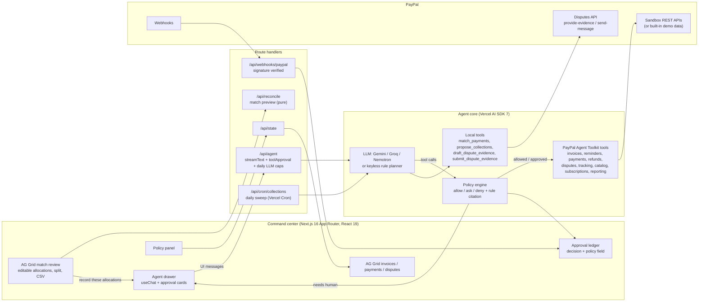

# Chaser

> Demo video (2:31): https://www.youtube.com/watch?v=nqY9uDsbKiM — Live demo: https://chaser-six.vercel.app

**Chaser matches every PayPal payment to the right invoice and handles what comes after.**

**Run against a real PayPal sandbox business account on 2026-10-10:** 8 invoices created and sent through the Agent Toolkit, 5 reminders sent by the agent loop under the policy gate (3 skipped as not yet due, each decision citing its rule), an external $800 payment recorded (`EXTR-3W091620YC457544T`, INV-0006 → PARTIALLY_PAID), and the Disputes API `provide-evidence` / `send-message` calls reaching PayPal (authenticated 404 on a probe id; no success claimed). Call-by-call JSON, the audit dump and screenshots are in [`docs/sandbox-evidence/`](docs/sandbox-evidence/); the table in [Verified on the PayPal sandbox](#verified-on-the-paypal-sandbox-2026-10-10) says what was and was not exercised.

Money arrives on PayPal and the work starts: a $1,400 transfer that covers two invoices, a $300 "part payment, rest next week", a $480 dispute from a client who already approved the work. Chaser is an accounts-receivable agent that does that work on PayPal, inside a policy you write as data:

- **Reconciliation you can edit.** The agent matches unlinked payments to open invoices (exact, partial, one payment across several invoices) with a confidence and a reason for each. An AG Grid **match review** lets you change any allocation, split a payment, or point it at a different invoice before it is recorded on PayPal.
- **Policy as data, decisions as a ledger.** Every tool call goes through a pure policy function that answers allow / ask / deny and cites the policy field it used. The **approval ledger** shows each decision with that field (`approvals.refundsOver = $500`), who decided (policy or you), and why.
- **Dispute evidence packs, end to end.** For a dispute above your auto-accept limit the agent assembles the evidence from what it already knows (invoice line items, payment record, shipment tracking, reminder history), drafts the seller statement, shows you the pack, and submits it through the **PayPal Disputes API** (`provide-evidence`, or `send-message` while it is an inquiry).

It also chases overdue invoices with reminders written from each invoice's actual line items, creates and sends invoices from a sentence, adds shipment tracking, and sets up retainers as subscriptions. Anything outside the policy becomes an approval card.

Built for the [PayPal AI Hackathon](https://paypalaihackathon.devpost.com/) on the **PayPal sandbox** (play money only), with the **PayPal Agent Toolkit**, the **Vercel AI SDK** and **AG Grid Community**. Live demo: **https://chaser-six.vercel.app** (demo data, no sign-in, every visitor gets an isolated copy; the hosted site runs the keyless rule planner, the drawer header says `model: rule planner (no LLM key)`).

## Why not PayPal's built-in reminders, or a chat bot over the toolkit

PayPal already sends invoices and automatic reminders (`setup_invoice_auto_reminders`), and a chat bot over the toolkit can call `send_invoice_reminder`. Chaser is for what those do not cover:

- **Payments that PayPal cannot link to an invoice.** [`src/lib/agent/reconcile.ts`](src/lib/agent/reconcile.ts) is a pure matcher (invoice number in the memo, payer + exact balance, payer + subset-sum across several invoices, payer + partial on the oldest) that returns a confidence and a reason per allocation; one transaction can carry several allocations. The match review ([`src/components/MatchReview.tsx`](src/components/MatchReview.tsx)) lets you edit, split or re-point lines before `record_payment_for_invoice` writes them to PayPal.
- **Dispute responses through the API the toolkit does not expose.** [`src/lib/paypal/rest.ts`](src/lib/paypal/rest.ts) calls `provide-evidence` (multipart) and `send-message` with the evidence pack assembled from invoice line items, payment record, shipment tracking and reminder history; the call path is in [`docs/sandbox-evidence/disputes-api-probe.json`](docs/sandbox-evidence/disputes-api-probe.json).
- **A policy you edit as data, and a ledger that names the field.** [`src/lib/policy/engine.ts`](src/lib/policy/engine.ts) (schema: [`src/lib/policy/schema.ts`](src/lib/policy/schema.ts)) answers allow / ask / deny for every tool call and cites the policy field; every row of [`docs/sandbox-evidence/2026-10-10-collections-audit.json`](docs/sandbox-evidence/2026-10-10-collections-audit.json) carries its `rule`.

## 60-second tour (no keys needed)

```bash
npm install
cp .env.example .env.local     # demo data + keyless planner by default
npm run dev                    # http://localhost:3000
```

1. **Payments tab.** Three PayPal payments arrived without an invoice link. The match review already shows the agent's proposal: an exact match (95%), a partial payment on the oldest open invoice (70%), and one $1,400 payment split across two invoices (90%), each with its reasoning. Change the $900 / $500 split to $1,000 / $400 and the over-allocation guard turns the lines red; make it $1,000 / $400 against $900 / $500 balances and click **Record 4 allocations**.
2. **Approval card.** Three lines are recorded straight away (policy: `reconciliation.autoRecordExactMatches`, `autoRecordPartials`). The $1,000 line exceeds the $900 still due on INV-0015, so it comes back as an approval card quoting the rule. Approve or deny; the agent continues either way and the remainder stays visible as **unapplied** until it is placed.
3. **Approvals tab.** The ledger: `allowed` by policy, `approval required`, `approved by you`, `denied`, each row with the policy field and value it was decided on. Open **Policy**, change a threshold, and the next decision changes with it.
4. **Review disputes.** The $15 dispute is accepted automatically (`disputes.autoAcceptUnder = $20`). For the $480 one the agent builds the evidence pack and, because `disputes.submitEvidence = ask`, shows it as an approval card with the full statement; approve and it goes to PayPal through the Disputes API, the dispute moves to *under PayPal review*, and the Disputes tab shows the submitted pack.
5. **Run collections.** Reminders at friendly / firm / final stages, one per client, quoting the work, the amount and the pay link, within the cadence limits (`reminders.*`).
6. Type `I finished the logo package for Acme Corp, $1,200, net 15`: lookup, `create_invoice`, `send_invoice`.
7. Type `Refund $600 on INV-0007`: over `approvals.refundsOver`, so an approval card.
8. **Fire webhook**: a real `INVOICING.INVOICE.PAID` event goes through the signature-checking handler and the invoice flips to PAID.

Add a free Gemini or Groq key and the same tools are driven by a real LLM; add PayPal sandbox credentials and the same agent acts on real sandbox invoices, payments and disputes.

## Architecture



**How a tool call flows.** The model proposes a tool call. The AI SDK's `toolApproval` hook asks Chaser's policy engine (`src/lib/policy/engine.ts`), a pure function over the current invoices, disputes and the user's policy. It answers *allow* (execute now), *ask* (stream an `approval-requested` part; the UI renders a card; the SDK resumes after the user's answer) or *deny* (the model receives an `execution-denied` result with the reason and reports it), and every answer names the policy field it came from. Executions, approval requests, your answers and denials are written to the audit log; the Approvals tab is that log filtered to decisions.

**Reconciliation.** `match_payments` (`src/lib/agent/reconcile.ts`) is a pure matcher over unapplied payments and open invoices: invoice number in the memo, same payer + exact balance, same payer + a subset of invoices summing to the amount, same payer + partial on the oldest invoice, amount-only hints at low confidence. One PayPal transaction can carry several allocations; what is not yet applied stays in the match review. Recording goes through `record_payment_for_invoice` (Invoicing v2), so PayPal's invoice balances are the source of truth.

**Where state lives.** The server is stateless between requests: the browser keeps the snapshot it last received (policy, demo data, overlays, audit) and sends it with every call; each route hydrates it into an `AsyncLocalStorage` context and returns the updated snapshot (the agent stream carries it as a final `data-snapshot` part). That makes the hosted demo serverless-safe and gives every visitor an isolated copy of the business. In sandbox mode PayPal is the source of truth for invoices, transactions and disputes; the snapshot keeps only what PayPal does not store for us (policy, reminder history, chase overrides, evidence drafts and submission records, audit). Server-to-server callers (PayPal webhooks, Vercel Cron) use a process-global store.

### PayPal capabilities used

Via [`@paypal/agent-toolkit`](https://www.npmjs.com/package/@paypal/agent-toolkit) 1.11.0 unless noted. `configuration.context.sandbox = true` throughout.

| Area | Tools | Where Chaser uses them |
|---|---|---|
| Invoicing v2 | `create_invoice`, `send_invoice`, `send_invoice_reminder`, `list_invoices`, `get_invoice`, `search_invoicing`, `generate_invoice_number`, `generate_invoice_qr_code`, `cancel_sent_invoice`, `record_payment_for_invoice`, `record_refund_for_invoice`, `setup_invoice_auto_reminders` | reconciliation write-back (full, partial and split payments); creating/sending invoices from natural language; policy-driven chasing |
| Transaction Search / Reporting | `list_transactions` | the payment stream the matcher reconciles against open invoices |
| Disputes v1 | `list_disputes`, `get_dispute`, `accept_dispute_claim` | auto-accepting small disputes; building evidence for the rest |
| Disputes v1 (REST, not in the toolkit) | `POST /v1/customer/disputes/{id}/provide-evidence` (multipart), `POST .../send-message` | `submit_dispute_evidence`: sends the evidence pack (evidence type, tracking info, seller notes), gated by `disputes.submitEvidence` |
| Payments v2 | `create_refund` | refunds (gated by amount) |
| Shipment Tracking | `create_shipment_tracking`, `get_shipment_tracking` | "shipped the brand book, UPS 1Z..."; tracking also feeds the evidence pack |
| Catalog + Subscriptions | `create_product`, `list_products`, `create_subscription_plan`, `list_subscription_plans`, `create_subscription`, `show_subscription_details`, `cancel_subscription` | monthly retainers for regular clients |
| Webhooks (REST) | `POST /v1/notifications/verify-webhook-signature` | `/api/webhooks/paypal` verifies and applies `INVOICING.INVOICE.PAID`, `PAYMENT.CAPTURE.COMPLETED`, `CUSTOMER.DISPUTE.CREATED/RESOLVED`, `BILLING.SUBSCRIPTION.ACTIVATED` |
| OAuth (REST) | `POST /v1/oauth2/token` | client-credentials token for the REST calls above |

### The policy (data, not prompt)

```jsonc
{
  "reminders":      { "friendlyAfterDays": 3, "firmAfterDays": 10, "finalAfterDays": 21, "minDaysBetweenReminders": 3, "maxReminders": 4 },
  "disputes":       { "autoAcceptUnder": 20, "submitEvidence": "ask" },          // ask | auto | never
  "approvals":      { "refundsOver": 500, "invoicesOver": 5000, "alwaysAsk": ["cancel_sent_invoice", "delete_invoice", "cancel_subscription"], "neverAllow": [] },
  "reconciliation": { "autoRecordExactMatches": true, "autoRecordPartials": true, "amountTolerance": 0.01 },
  "currency": "USD"
}
```

`src/lib/policy/schema.ts` (zod) validates it; `src/lib/policy/engine.ts` evaluates it; the Policy panel edits it; the ledger cites it. The LLM never decides what it may do alone.

### AI

- **Agent loop**: Vercel AI SDK 7 `streamText` with `stopWhen: stepCountIs(14)`, tools, and the `toolApproval` hook for human-in-the-loop; UI with `@ai-sdk/react` `useChat`, typed tool parts and `addToolApprovalResponse`.
- **Models (all free tiers, no card)**: Google AI Studio Gemini (`@ai-sdk/google`), Groq (`@ai-sdk/groq`), Nebius Token Factory NVIDIA Nemotron (`@ai-sdk/openai-compatible`). Pick one by setting its key.
- **Daily caps for a hosted key**: `/api/agent` keeps per-visitor and global per-day buckets (`AGENT_LLM_RUNS_PER_IP_PER_DAY`, default 20; `AGENT_LLM_RUNS_PER_DAY`, default 300; UTC days, per instance). Past the cap the request runs on the keyless planner and the drawer says so, so a free-tier key on a public URL cannot be burned.
- **Keyless planner**: `src/lib/llm/mock-model.ts` is a `LanguageModelV3` that plans tool calls with rules instead of weights. It follows the same playbook as the system prompt, so the full product (agent loop, policy gate, approval cards, ledger) runs with zero API keys and the end-to-end tests run the real SDK loop.
- **Deterministic helpers the model calls**: `match_payments`, `propose_collections`, `draft_dispute_evidence`, `submit_dispute_evidence`, `lookup_customer`, `summarize_receivables`, `set_chase_override`. Small models behave because the planning is done in code and the model acts on structured results.

### AG Grid (Community, MIT)

- **Match review** (`src/components/MatchReview.tsx`): one row per proposed allocation; `agSelectCellEditor` to re-point a line at another open invoice, an editable amount with `valueSetter` and `enableCellChangeFlash`, "Split payment" to add a line, per-payment over-allocation guard via `cellClass` / `rowClassRules`, pinned totals, CSV export of the reconciliation (`exportDataAsCsv`), and a Record button that hands the reviewed lines to the agent.
- **Approval ledger** (`src/components/ApprovalLedger.tsx`): decisions with the policy field and its current value, filterable and exportable.
- **Invoice grid**: sorting/filtering/quick filter, multi-row checkbox selection that drives "Chase selected" / "Pause selected", inline editing of the per-invoice chasing policy with `agSelectCellEditor` (persisted and audited), custom renderers, `rowClassRules` by overdue severity, pinned totals, Theming API (`themeQuartz` light/dark), `getRowId` live updates.
- **Payments and disputes grids**: allocation chips and unapplied badges per transaction; selecting a dispute opens the evidence pack with a submit action.

## Verified on the PayPal sandbox (2026-10-10)

The sandbox path was run against a real PayPal sandbox business account with `MOCK_PAYPAL=0` and the app's own Client ID / Secret (`@paypal/agent-toolkit` 1.11.0, `https://api-m.sandbox.paypal.com`). Evidence (redacted of nothing but credentials, which never leave `.env.local`) is in [`docs/sandbox-evidence/`](docs/sandbox-evidence/): the call-by-call JSON from `npm run sandbox:check`, the audit dump from a real "Run collections", the Disputes API probe, and screenshots of the UI in sandbox mode (file names are the captions of the video drop-in).

| Exercised against PayPal | Result |
|---|---|
| `create_invoice` x8 (`npm run seed -- --limit=8`) | 8 invoices created, ids `INV2-…`; the seed is idempotent (re-run deletes stale drafts with `delete_invoice`) |
| `send_invoice` x8 | all 8 SENT to the demo recipients |
| `list_invoices`, `get_invoice` | 8 listed; summaries carry no line items, so the command center fetches `get_invoice` per invoice (bounded) |
| `send_invoice_reminder` x5 from the real agent loop ("Run collections", keyless planner, policy gate, audit) | 5 reminders sent (INV-0001 final, INV-0010 final, INV-0002 firm, INV-0006 firm, INV-0003 friendly); 3 skipped as not yet due; see `2026-10-10-collections-audit.json` |
| `record_payment_for_invoice` (external $800 on INV-0006) | `payment_id: EXTR-…`, invoice became PARTIALLY_PAID with $1,000 due, visible in the grid |
| `list_disputes` | 0 disputes (none can be opened from the seller side) |
| Disputes API `provide-evidence` and `send-message` (plain REST, multipart) | probed with a non-existent dispute id: authenticated `404 RESOURCE_NOT_FOUND` from PayPal for both, i.e. OAuth, endpoint and body are accepted up to resource lookup (`disputes-api-probe.json`). No success claimed |
| OAuth `v1/oauth2/token` | used by the REST calls above |

**Not exercised (needs a buyer or a dashboard toggle):** `list_transactions` answered `403` because Transaction Search is not enabled on this sandbox app (developer dashboard -> the app -> Features); so reconciliation against real sandbox payments, a buyer paying an invoice, webhooks, refunds (`create_refund`), accepting a dispute and a successful `provide-evidence` were not run against PayPal. Those paths run in demo mode with sandbox-shaped responses and are covered by the test suite.

**What the real responses changed in the code:** Invoicing v2 rejects an `invoicer_email_address` that is not the account's own (`422 User is not associated with paypal based on invoicer email`), so a placeholder merchant email is omitted and PayPal fills in its own; `links[rel=self]` is the API resource, the human pages are `detail.metadata.invoicer_view_url` / `recipient_view_url`; the due date comes from `detail.payment_term.due_date` when set, else from the terms written into the note (the toolkit's `create_invoice` has no `payment_term`); toolkit HTTP errors come back as `{ ok: false, status, code, message }` and are now raised instead of being handed to the mappers.

## Setup

### 1. Demo data (default)

No accounts needed. With no PayPal credentials (or `MOCK_PAYPAL=1`) Chaser serves 20 realistic invoices, 11 transactions, 2 disputes and 1 shipment from memory with PayPal-shaped responses; with no LLM key the keyless planner runs the agent. **Reset demo** restores the data.

### 2. Real LLM (free)

Set **one** of these in `.env.local`:

```
GOOGLE_GENERATIVE_AI_API_KEY=...   # https://aistudio.google.com/apikey  (default model gemini-2.5-flash)
GROQ_API_KEY=...                   # https://console.groq.com/keys      (default openai/gpt-oss-120b)
NEBIUS_API_KEY=...                 # Token Factory, NEBIUS_MODEL for a Nemotron model id
```

`LLM_MODEL` overrides the model id for whichever provider is active. On a public deployment also set `AGENT_LLM_RUNS_PER_IP_PER_DAY` / `AGENT_LLM_RUNS_PER_DAY` (see above).

### 3. PayPal sandbox

1. [developer.paypal.com/dashboard](https://developer.paypal.com/dashboard/) -> Apps & Credentials -> **Sandbox** -> your app -> copy **Client ID** and **Secret** into `.env.local` as `PAYPAL_CLIENT_ID` / `PAYPAL_CLIENT_SECRET`, and set `MOCK_PAYPAL=0`.
2. `npm run seed -- --limit=8` creates the demo invoices in your sandbox through the toolkit (`--no-send` keeps them as drafts).
3. Pay one as the sandbox *personal* account at [sandbox.paypal.com](https://www.sandbox.paypal.com/) (Testing Tools -> Sandbox Accounts has the login); click **Refresh** and watch it reconcile. Open a dispute on a paid transaction from the sandbox buyer's Resolution Center to try the evidence pack.
4. Webhooks: in the app's settings add a webhook for your deployed `/api/webhooks/paypal` with the event types listed above and set `PAYPAL_WEBHOOK_ID`. Locally, a free tunnel (`cloudflared tunnel --url http://localhost:3000`) works.

### 4. Deploy (Vercel Hobby, free)

Import the repo, add the environment variables you want, deploy. `vercel.json` schedules `/api/cron/collections` daily (set `CRON_SECRET`). The cron run is unattended: it only performs policy-allowed actions and leaves anything that needs you in the ledger.

## Scripts

```bash
npm run dev        # Next.js dev server
npm run build      # production build (passes with zero config)
npm test           # 69 vitest tests: policy engine + rule citations, matcher, split allocations, match-review round trip,
                   # evidence pack + Disputes API call path, LLM caps, end-to-end agent loop, serverless snapshot isolation
npm run typecheck  # tsc --noEmit
npm run lint       # eslint (Next + React Compiler rules)
npm run seed       # seed the PayPal sandbox
python scripts/make_video.py   # demo video: Playwright drives the live app, edge-tts narrates, ffmpeg cuts
```

## Sponsor prize mapping

| Prize | Why Chaser qualifies |
|---|---|
| **Top 3** | A complete product around a real daily pain (money arrives, which invoice is it; a dispute opens, what now): editable reconciliation, policy as data with a cited ledger, dispute evidence through the Disputes API, webhooks, cron, tests, demo mode. |
| **Best Use of PayPal + AI** | Invoicing v2, Transaction Search, Payments v2, Disputes v1 (including `provide-evidence`, which the toolkit does not expose), Shipment Tracking, Catalog, Subscriptions and Webhooks, all driven by an LLM agent whose every action is policy-gated and audited. |
| **Best Use of AG Grid** | The grid is where the human works: the match review edits what the agent proposed before it touches PayPal; the ledger makes policy decisions inspectable; inline policy edits per invoice; selection drives agent actions. |
| **Best Use of Agentic Commerce** | A seller-side agent that transacts on PayPal (invoices, reminders, payment records, refunds, dispute responses, tracking, subscriptions) within user-defined limits. |
| **Best Demo Delivery** | 3-minute end-to-end story (`SUBMIT.md`); everything reproduces locally with `npm run dev` and no keys. |

## Security and scope

- Sandbox only. Every number in the demo is play money; the UI says so.
- No secrets in the repo; `.env*` is git-ignored (only `.env.example` is tracked). Webhooks are signature-verified before anything is applied.
- Money-moving actions outside the policy need an explicit click. Unattended runs (cron) never perform them. Evidence submission is "ask" by default because it is a statement made on the seller's behalf.
- A hosted LLM key is protected by daily caps; the demo falls back to the keyless planner.

## Notes on the PayPal Agent Toolkit (things we learned)

- `@paypal/agent-toolkit@1.11.0` builds its tools for Vercel AI SDK **v4** (`parameters`, `maxSteps`); the current SDK is **v7** (`inputSchema`, `stopWhen`, `toolApproval`). Chaser keeps the toolkit's zod schemas and descriptions verbatim and re-wraps them (`src/lib/agent/tools.ts`), so the model sees the official tool definitions.
- `create_invoice` has no `payment_term`; terms go in the note (and `update_invoicing` can set them later). `items[].quantity` and all money values are **strings**.
- `accept_dispute_claim.note` is validated against `^[A-Za-z0-9_-]{1,255}$` (no spaces). The system prompt tells the model.
- There is no toolkit tool for `provide-evidence` / `send-message`; `src/lib/paypal/rest.ts` calls them directly (multipart `input` part for evidence) with the same app credentials.
- `get_merchant_insights` throws in sandbox mode; Chaser's `summarize_receivables` computes the metrics locally instead.
- `list_transactions` (Transaction Search) accepts at most a 31-day window per call; sandbox reporting can lag, so webhooks are the primary reconciliation trigger.

## AI tools used to build this

Claude Code (Anthropic) wrote and tested the code with the author directing design, policy semantics and the demo story.

## License

MIT - see [LICENSE](LICENSE).
