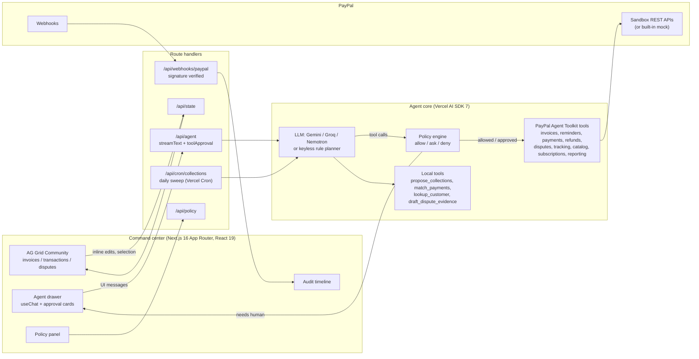

# Chaser

**An AI agent that collects your invoices on PayPal, within the rules you set.**

Freelancers and small merchants do not struggle to *send* invoices. They struggle with everything after: chasing late payers, matching money that arrives to the invoice it belongs to, and dealing with disputes. Chaser is an accounts-receivable agent that does that work on PayPal: it creates and sends invoices, sends policy-driven reminders written for each client, reconciles payments (including partial and multi-invoice payments), triages disputes, adds shipment tracking and sets up retainers. You set the policy; the agent acts inside it and asks you at the edges.

Built for the [PayPal AI Hackathon](https://paypalaihackathon.devpost.com/) on the **PayPal sandbox** (play money only), with the **PayPal Agent Toolkit**, the **Vercel AI SDK** and **AG Grid Community**.

## 60-second tour (no keys needed)

```bash
npm install
cp .env.example .env.local     # MOCK_PAYPAL=1 is the default: built-in mock PayPal + keyless planner
npm run dev                    # http://localhost:3000
```

Then, in the command center:

1. **Run collections** - the agent applies your reminder policy to 20 demo invoices and sends friendly / firm / final reminders that quote the actual work, amount and pay link. Each action lands in the audit timeline with its reason.
2. **Reconcile payments** - three PayPal payments arrived without an invoice link: an exact match, a partial payment, and one payment covering two invoices. The agent explains each match and records it; the grid turns green.
3. **Review disputes** - a $15 dispute is accepted automatically (under your limit); a $480 dispute gets an evidence pack drafted for you.
4. Type `I finished the logo package for Acme Corp, $1,200, net 15` - the agent looks the client up, creates the invoice and sends it.
5. Type `Refund $600 on INV-0007` - that is over your $500 refund threshold, so an **approval card** appears. Approve or deny; the agent continues either way and records your decision.
6. Pick an invoice in **Simulate: client pays** and click **Fire webhook** - a real `INVOICING.INVOICE.PAID` webhook goes through the handler and the invoice flips to PAID.

Add a free Gemini or Groq key and the same tools are driven by a real LLM; add PayPal sandbox credentials and the same agent acts on real sandbox invoices.

## Architecture



**How a tool call flows.** The model proposes a tool call. The AI SDK's `toolApproval` hook asks Chaser's policy engine (`src/lib/policy/engine.ts`), a pure function over the current invoices, disputes and the user's policy. It answers *allow* (execute now), *ask* (stream an `approval-requested` part; the UI renders a card; the SDK resumes after the user's answer) or *deny* (the model receives an `execution-denied` result with the reason and reports it). Every execution and every decision is written to the audit timeline with its reason.

### PayPal capabilities used

All via [`@paypal/agent-toolkit`](https://www.npmjs.com/package/@paypal/agent-toolkit) 1.11.0 unless noted. `configuration.context.sandbox = true` throughout.

| Area | Tools | Where Chaser uses them |
|---|---|---|
| Invoicing v2 | `create_invoice`, `send_invoice`, `send_invoice_reminder`, `list_invoices`, `get_invoice`, `search_invoicing`, `generate_invoice_number`, `generate_invoice_qr_code`, `cancel_sent_invoice`, `record_payment_for_invoice`, `record_refund_for_invoice`, `setup_invoice_auto_reminders` | creating/sending invoices from natural language; policy-driven chasing; reconciliation write-back |
| Transaction Search / Reporting | `list_transactions` | pulling the payment stream that the matcher reconciles against open invoices |
| Payments v2 | `create_refund` | refunds (gated by amount) |
| Disputes v1 | `list_disputes`, `get_dispute`, `accept_dispute_claim` | auto-accepting small disputes; evidence drafting for large ones |
| Shipment Tracking | `create_shipment_tracking`, `get_shipment_tracking` | "shipped the brand book, UPS 1Z..." |
| Catalog + Subscriptions | `create_product`, `list_products`, `create_subscription_plan`, `list_subscription_plans`, `create_subscription`, `show_subscription_details`, `cancel_subscription` | monthly retainers for regular clients |
| Webhooks (REST) | `POST /v1/notifications/verify-webhook-signature` | `/api/webhooks/paypal` verifies and applies `INVOICING.INVOICE.PAID`, `PAYMENT.CAPTURE.COMPLETED`, `CUSTOMER.DISPUTE.CREATED/RESOLVED`, `BILLING.SUBSCRIPTION.ACTIVATED` |
| OAuth (REST) | `POST /v1/oauth2/token` | client-credentials token for the webhook verification call |

### AI

- **Agent loop**: Vercel AI SDK 7 `streamText` with `stopWhen: stepCountIs(14)`, tools, and the `toolApproval` hook for human-in-the-loop; UI with `@ai-sdk/react` `useChat`, typed tool parts and `addToolApprovalResponse`.
- **Models (all free tiers, no card)**: Google AI Studio Gemini (`@ai-sdk/google`), Groq (`@ai-sdk/groq`), Nebius Token Factory NVIDIA Nemotron (`@ai-sdk/openai-compatible`). Pick one by setting its key.
- **Keyless planner**: `src/lib/llm/mock-model.ts` is a `LanguageModelV3` that plans tool calls with rules instead of weights. It follows the same playbook as the system prompt, so the full product (agent loop, policy gate, approval cards, audit) runs with zero API keys. Swap in a real model by setting a key; nothing else changes.
- **Deterministic helpers the model calls**: `propose_collections` (policy -> reminder plan), `match_payments` (exact / partial / combined-invoice matching with confidence and reasoning), `lookup_customer`, `draft_dispute_evidence`, `summarize_receivables`, `set_chase_override`.

### AG Grid (Community, MIT)

The product's main surface is the invoice grid: sorting and filtering on every column, quick filter, multi-row checkbox selection (feeds "Chase selected" / "Pause selected" / "Ask about selected"), inline editing of the per-invoice **Chasing** policy with `agSelectCellEditor` (persisted via `PATCH /api/invoices/:id` and audited), custom cell renderers (status badges, overdue colouring, pay links), `rowClassRules` that tint overdue rows by severity, a pinned totals row, the Theming API (`themeQuartz` with light/dark parts), and `getRowId` for live transaction updates while the agent works. Transactions and disputes get their own grids; selecting a dispute reveals the drafted evidence pack.

## Setup

### 1. Mock mode (default)

No accounts needed. `MOCK_PAYPAL=1` serves 20 realistic invoices, 11 transactions, 2 disputes and 1 shipment from memory; with no LLM key the keyless planner runs the agent. **Reset demo** restores the data.

### 2. Real LLM (free)

Set **one** of these in `.env.local`:

```
GOOGLE_GENERATIVE_AI_API_KEY=...   # https://aistudio.google.com/apikey  (default model gemini-2.5-flash)
GROQ_API_KEY=...                   # https://console.groq.com/keys      (default openai/gpt-oss-120b)
NEBIUS_API_KEY=...                 # Token Factory, NEBIUS_MODEL for a Nemotron model id
```

`LLM_MODEL` overrides the model id for whichever provider is active.

### 3. PayPal sandbox

1. [developer.paypal.com/dashboard](https://developer.paypal.com/dashboard/) -> Apps & Credentials -> **Sandbox** -> Create App -> copy **Client ID** and **Secret** into `.env.local` as `PAYPAL_CLIENT_ID` / `PAYPAL_CLIENT_SECRET`, and set `MOCK_PAYPAL=0`.
2. `npm run seed` creates the demo invoices in your sandbox through the toolkit (`--limit=N`, `--no-send`).
3. Pay one as the sandbox *personal* account at [sandbox.paypal.com](https://www.sandbox.paypal.com/) (Testing Tools -> Sandbox Accounts has the login) and watch it reconcile.
4. Webhooks: in the app's settings add a webhook for your deployed `/api/webhooks/paypal` with the event types listed above and set `PAYPAL_WEBHOOK_ID`. Locally, a free tunnel (`cloudflared tunnel --url http://localhost:3000`) works.

### 4. Deploy (Vercel Hobby, free)

Import the repo, add the same environment variables, deploy. `vercel.json` schedules `/api/cron/collections` daily (set `CRON_SECRET`). The cron run is unattended: it only performs policy-allowed actions and leaves anything that needs you in the audit timeline.

## Scripts

```bash
npm run dev        # Next.js dev server
npm run build      # production build (passes with zero config)
npm test           # 42 vitest tests: policy engine, chasing planner, reconciliation, tool schemas, end-to-end agent loop
npm run typecheck  # tsc --noEmit
npm run lint       # eslint (Next + React Compiler rules)
npm run seed       # seed the PayPal sandbox
```

## Sponsor prize mapping

| Prize | Why Chaser qualifies |
|---|---|
| **Top 3 (Technological implementation, design, impact, innovation, presentation)** | Complete product, not a PoC: policy configuration, approval cards, audit trail, webhooks, cron, tests, mock mode. Solves a real, daily pain for freelancers (late payment). |
| **Best Use of Agentic Commerce** | The agent transacts on PayPal: it creates and sends invoices, sends reminders, records payments, issues refunds, accepts disputes, adds tracking and creates subscriptions, with a user-defined policy deciding what it may do alone. |
| **Best Use of PayPal + AI** | Eight toolkit areas (invoicing, reminders, reporting, payments, disputes, tracking, catalog, subscriptions) plus webhooks, all driven by an LLM agent with human-in-the-loop approvals. The LLM also writes the reminder copy from the invoice context. |
| **Best Demo Delivery** | Scripted 3-minute end-to-end story (see `SUBMIT.md`); everything in the video reproduces locally with `npm run dev` and no keys. |
| **Best Use of AG Grid** | The grid *is* the product: policy edited inline per row, selection drives agent actions, live updates as the agent works, custom renderers, row rules, pinned totals, theming API. |

## Security and scope

- Sandbox only. Every number in the demo is play money; the UI says so.
- No secrets in the repo; `.env*` is git-ignored. Webhooks are signature-verified before anything is applied.
- Money-moving actions outside the policy need an explicit click. Unattended runs (cron) never perform them.
- Not a mobile app; no real funds are ever moved.

## Notes on the PayPal Agent Toolkit (things we learned)

- `@paypal/agent-toolkit@1.11.0` builds its tools for Vercel AI SDK **v4** (`parameters`, `maxSteps`); the current SDK is **v7** (`inputSchema`, `stopWhen`, `toolApproval`). Chaser keeps the toolkit's zod schemas and descriptions verbatim and re-wraps them (`src/lib/agent/tools.ts`), so the model sees the official tool definitions.
- `create_invoice` has no `payment_term`; terms go in the note (and `update_invoicing` can set them later). `items[].quantity` and all money values are **strings**.
- `accept_dispute_claim.note` is validated against `^[A-Za-z0-9_-]{1,255}$` (no spaces). The system prompt tells the model.
- `get_merchant_insights` throws in sandbox mode; Chaser's `summarize_receivables` computes the metrics locally instead.
- `list_transactions` (Transaction Search) accepts at most a 31-day window per call; sandbox reporting can lag, so webhooks are the primary reconciliation trigger.

## AI tools used to build this

Claude Code (Anthropic) wrote and tested the code with the author directing design, policy semantics and the demo story.

## License

MIT - see [LICENSE](LICENSE).
